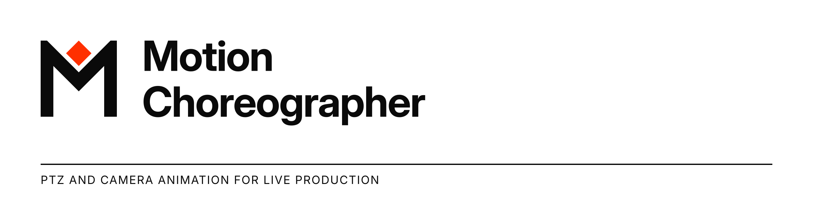

<picture>
  <source media="(prefers-color-scheme: dark)" srcset="brand/social/readme-banner-dark.png">
  
</picture>

**Motion Choreographer**: timeline programming and playout for up to twelve
Sony FR7 cameras, each on an AutoPod+ pedestal.

You build a song by dragging camera presets onto a timeline. Each move takes its
time from the distance between the two poses and the rig's speed limits, and you
can stretch, squeeze, ease or key it by hand. Every camera has its own lane, its
own lens and its own place in a 3D model of the venue, so the monitors show what
each one will frame before anything moves. The show runs on a server; the
desktop app connects to it from the same Mac or from another machine.

Two programs:

- **`ptz-server`** owns the show: songs and their revisions, the transport, the
  clock, the rig, the run log. It keeps running when the app is closed.
- **`ptz-app`** is the operator's window: timeline, presets, monitors, inspector.
  It is a native app (Rust, `egui`), not a web page.

A third program is optional: **`ptz-panel`** lets a SKAARHOJ PTZ Pro hardware
panel hold the edit lease and run the show, without a mouse or a keyboard. See
[Control from a SKAARHOJ panel](#control-from-a-skaarhoj-panel).

Until hardware is configured the server drives a built-in simulator rig, so
everything can be programmed and rehearsed with nothing plugged in.

Three documents go with this one:

- **[PTZ Pro: setup and programming](docs/ptz-pro.md)**: put a SKAARHOJ PTZ Pro
  on the show and program songs from it. Start here if that is the panel you
  use.
- **[Setup Guide](docs/setup-guide.md)**: from a new machine to a system that is
  ready to program, including bringing up each real rig and a checklist for
  the first show.
- **[Programming Manual](docs/programming-manual.md)**: how to build, shape,
  rehearse and play a show in the app, with a first-song walkthrough and a
  reference.

The same three, as a web page with search and a contents list:

```sh
cd manual && npm install && npm run dev    # http://127.0.0.1:43123
```

## Run it

Rust 1.95 or newer (`rustup update stable`).

```sh
make run-server     # data in ~/PTZProgrammer, listens on http://127.0.0.1:8787
make run-app        # in a second terminal
```

The app connects on launch to the server it last used, `http://127.0.0.1:8787`
the first time. If no server answers, the connect screen offers **Start a
server on this computer**: `ptz-server` with its defaults, which keeps running
after the app quits and drives whatever rig the project in `~/PTZProgrammer`
names.

A first run seeds three presets (Stage Wide, Lectern MCU, Awards Two-Shot) and
three songs (Walk-In, Opening Number, Awards Bed). `ptz-server --no-seed` starts
empty.

On Linux the app needs the usual X11 or Wayland libraries and the server needs
the ALSA headers (`libasound2-dev`).

### Install on a Mac

```sh
make install-mac
```

Builds for this Mac (Apple Silicon or Intel), assembles `Motion Choreographer.app`
with the three command-line tools inside it, signs it ad hoc, copies it to
`~/Applications` and links `ptz-server`, `ptz-probe`, `ptz-bringup` and `ptz-panel` into
`~/.local/bin`. Running it again installs a newer version over the old one; it
asks you to quit the app and stop the server first. A copy under the app's
old name, `PTZ Programmer.app`, is removed when the new one goes in. `make
uninstall-mac` removes the app (under either name) and the links and leaves
the show data alone.

The ad hoc signature is enough for the Mac that built it. A second Mac, for a
remote station, builds its own copy the same way.

### Installers

```sh
make package
```

Builds for the machine it is run on and writes two installers into `dist/`:

| | On a Mac | On Linux |
| --- | --- | --- |
| The app, with the show server as an option | `Motion-Choreographer-<version>-macos-<arch>.pkg` | `motion-choreographer-<version>-linux-<arch>.run` |
| The show server and tools alone | `Motion-Choreographer-Server-<version>-macos-<arch>.pkg` | `motion-choreographer-server-<version>-linux-<arch>.run` |

The app installer always installs the app. **Show server and tools**
(`ptz-server`, `ptz-probe`, `ptz-bringup`, `ptz-panel`) is a checkbox in the Mac installer,
ticked to start with, and a question in the Linux one (`--with-server` and
`--no-server` answer it in advance). Clear it on a station that only connects
to a server elsewhere; use the server installer on a machine that runs the
show without a screen.

- **Mac:** the app goes to `/Applications` (replacing a copy under its old
  name, `PTZ Programmer.app`), the server and tools to
  `/usr/local/ptz-programmer/bin`, which the installer puts on PATH for new
  terminals. The packages are not signed with a Developer ID unless
  `PTZ_INSTALLER_SIGN` names one, so on another Mac open one with a
  right-click and **Open**, or run `sudo installer -pkg <file> -target /`.
- **Linux:** `sh motion-choreographer-<version>-linux-<arch>.run` installs under
  `~/.local` (or `--prefix`), with an entry in the applications menu.
  `--uninstall` removes what it installed.

An app installed without the server greys out **Start a server on this
computer** and says why.

A Mac installer has to be built on a Mac: macOS programs cannot be compiled
anywhere else. An Apple Silicon Mac builds the Intel pair as well:

```sh
make package                                    # for this Mac
PTZ_TARGET=x86_64-apple-darwin make package     # for Intel Macs, from an Apple Silicon one
```

### Updates

A released copy of the Mac app looks for a newer version when it opens and
every six hours after that. When there is one it says so, and **View** shows
**Update to <version>**. **Install and reopen** downloads the installer, checks
it, asks for the Mac's password once, installs it, and reopens the app. If the
show server runs on that Mac it is restarted too, so that it is the new version
as well. Because the app and the server close, the button is off until the
show is stopped, in rehearse, and not recording. The data folder is not touched.

A new version is published with one command, on the Mac that holds the release
keys:

```sh
scripts/release.sh 0.1.1 "A scroll bar along the bottom of the timeline."
```

It sets the version, builds the installers, signs a description of them,
commits and tags the version, pushes it, and publishes the installers as a
GitHub release. It refuses to start with uncommitted changes, off `main`, or
when the update service does not answer.

How it fits together:

- **GitHub Releases** hold the installers, a description of the release
  (`update-<platform>.json`: version, installer name, size and SHA-256, notes)
  and its signature.
- **The update service** (`updates/`, a Cloudflare Worker) is the address the
  app asks. The repository is private, so the Worker holds a read-only GitHub
  token and hands the app the description and a short-lived link to the
  installer. It answers only requests that carry the update key.
- **The app** installs nothing it cannot verify: the description has to be
  signed by the release key whose public half is `crates/app/update-signing.pub`,
  be for this kind of Mac, be a later version, and the download has to match
  the size and SHA-256 in it. Neither GitHub nor Cloudflare holds the signing key.

The keys are in `~/.ptz-release` on the release Mac, never in the repository:
`signing-key.pem` signs releases, and `update-key` is what apps send to the
service. **Back that folder up.** Without `signing-key.pem` no installed copy
will accept another update, and each would have to be reinstalled by hand.
`node updates/tools/release-tool.mjs keys` makes them the first time.

Setting the service up, once:

```sh
cd updates
npm install
npx wrangler login
npx wrangler deploy                      # prints the address; put it in updates/service-url
tr -d '\n' < ~/.ptz-release/update-key | npx wrangler secret put UPDATE_KEY
npx wrangler secret put GITHUB_TOKEN     # paste the token when asked
```

It is deployed at `https://ptz-updates.flybar.workers.dev`, on the Cloudflare
account named in `updates/wrangler.jsonc`. A new address takes a few minutes
to answer the first time.

The GitHub token is a fine-grained one, limited to this repository, with
**Contents: Read-only** and nothing else. When it expires the app says that
GitHub refused the update service's token; make a new one and run the last
line again.

A copy built with `make package` or `cargo build` has no update address in it
and never looks: **View → Updates** says so. Only `scripts/release.sh` builds
copies that update themselves. Linux copies do not update themselves yet.

### A remote operator station

```sh
ptz-server --bind 0.0.0.0:8787 --access-key "choose-a-key"
```

The server refuses to listen beyond this machine without a key. Enter the
server address and the key on the app's connect screen.

## Building a song

1. **New** in the header. Name the song and give it the timecode its first frame
   plays at, for example `01:00:00:00`.
2. Drag a preset from the **Presets** tab onto the timeline. It lands on the
   **Camera move** lane at the pointer's time, whichever lane the pointer is
   over. The ghost shows where it lands and how long the move takes: `Stage
   Wide to Lectern MCU, 7.9 s`. A move starts from wherever the camera already is.
   Drag a preset onto a move that is already there to change where that move
   goes, without moving it in time.
   To give new drops a fixed length, enter seconds in **Drop time** beside the
   presets. **Auto** restores timing from the rig limits. This choice is saved
   for this station; existing moves keep their time. A fixed move that does
   not fit is refused, and one faster than the rig can perform still shows
   the usual warnings.
3. Drag a move to slide it. Drag its right edge to make it longer; it switches
   from auto time to custom time. Squeeze it too short and it turns amber with
   the reason; **Use auto time** in the Inspector clears it.
4. Press **Space** to rehearse. The Program monitor shows the selected camera's
   framing through its lens; nothing is sent to the rig.
5. **Save**, then **Commit**. Only a committed revision can be armed.

Edges snap to the playhead, markers and other clips; hold Shift to turn snapping
off. Cmd-Z and Shift-Cmd-Z undo and redo. Cmd-S or Ctrl-S saves. `M` adds a
marker, `\` fits the song to the window, Home cues to the start, the arrow keys
step one frame.

Select clips, markers or keys and use **Copy** / **Paste** in the timeline
toolbar or right-click menu, or Ctrl-C / Ctrl-V (Cmd-C / Cmd-V on Mac).
Paste starts at the playhead and keeps relative spacing, camera lanes, media
trims and copied durations. It is one undo step. Preset copies keep their time
as Custom; their linked start still follows the destination timeline. Clips
can be copied between songs on the same server. After reconnecting or refreshing
the media library, copy media clips again before pasting. Overlaps, unavailable cameras
or media, and a different frame rate are refused without changing the song.
Text fields keep their normal clipboard shortcuts.

## Cameras

A show holds one to twelve cameras. The camera bar under the song header lists
them; click one, or press `1` to `9`, `0`, `-` and `=`, to select it. The
Program monitor, the Presets tab and the Rig controller follow the selected
camera. Record watches every camera and writes the ones that are moved. Each
camera has its own **Camera move** lane on the timeline, with its own axis
lanes. A preset belongs to one camera and always lands on
that camera's lane, whichever lane the pointer is over. A move can be dragged
to another camera's lane afterwards.

Everything that belongs to the whole show and not to one song is in **Show
settings**: press the button at the right end of the camera bar. It takes the
place of the panels until **Close settings** or Esc; the header, the transport
with E-STOP and the camera bar stay on screen. Its pages are listed at the
left: the show (Cameras, Frame rate and faults, Stage model, Programming),
the selected camera (Rig connection, Lens, Position on the stage, Rig limits,
Keep-out rules) and the server (Audio output, Timecode inputs, Control
panel). Changing anything there needs the edit lease, with the show disarmed.

Cameras are added, named, reordered and removed on its **Cameras** page.
**Add a camera** copies the selected camera's
lens, limits and rules onto a new one on the simulator, two metres to its
right. Removing a camera removes its presets, and its clips block Arm until
they are deleted. Rig limits, keep-out rules, the rig settings, the lens and
the position below it are those of the selected camera.

**When a camera faults** chooses what the others do: *Hold that camera, the
others carry on* (the default), or hold them all. E-Stop always stops every
camera.

The **Multiview** tab shows every camera's picture at once, in a grid that
grows from one tile to four by three, with each camera's name, state and focal
length. Click a tile to select that camera.

### Lenses

Each camera has a lens: its name, the sensor width (full frame, Super 35 or a
typed width), the focal length at the wide and long ends, and the widest
aperture. The list offers the FR7 kit zoom (FE PZ 28-135mm F4 G OSS) and four
other E-mount zooms; any other lens is typed in.

From those the **Lens** page of Show settings shows, for the zoom the camera is at now: the focal
length, the angle of view (wide, high and diagonal), how far away the centre of
the frame lands in the stage model, how wide and high the frame is there, and
the range that is sharp at that distance. Tick **At a distance of** to work
those out for a typed distance instead. Every picture in the app (Program,
Multiview, the preset cards, the view cones in the Stage view) is drawn with
these numbers, so changing a lens changes the framing everywhere.

Zoom is taken to run evenly in stops from the wide end to the long end.
Bring-up can check that against the real lens.

### The stage model

The Program monitor is a rendering of the venue from where the camera stands.
Until a model is imported it shows a small built-in stage. To use your own:

- Drop an `.obj` or `.3ds` file on the window, or use **Import a model** in the
  Show settings under **Stage model** (or type its path in the field beside it).
- An OBJ's `.mtl` file is read from the same folder for its colours. Textures
  are not used; each surface takes its material's colour.
- The app reads the file and sends the server a compact mesh, so every station
  sees the same model. Up to 1.5 million triangles and 200 MB.

The Stage model page then shows the model's size in metres. If it is wrong, change
**One unit is** (millimetres, centimetres, metres, inches, feet; the first guess
comes from the model's size) or **Up** (OBJ files are taken as Y up, 3DS as Z
up). **Turned** and **Moved** place it; **Sit on the floor** puts its lowest
point at height zero and **Centre** puts its middle over the origin. **Remove
the model** brings the built-in stage back for every station.

Distances are in metres, Z is up, and a camera with heading 0 and pan 0 looks
along +Y.

The native visualization uses rounded people and PTZ models, studio lighting,
soft shadows and antialiasing on OpenGL 3.3 or newer. The same geometry is used
for camera previews, placement and picking. If advanced rendering cannot start,
the app uses basic CPU shading; `PTZ_RENDERER=cpu` also selects it for troubleshooting.
The [render comparison study](design/render-prototype/README.md) preserves the
original block-model captures alongside the approved visual direction.

### Placing cameras: the Stage view

The **Stage** tab shows the model from outside with every camera, its name and
the cone it sees, which follows its pan, tilt, zoom and lens as the song plays.

Turn on **Camera placement** to open a full workspace with the selected camera's
simulated view beside the stage. The transport stays available; choose **Done
placing** (or turn **Camera placement** off) to return to the saved panel layout. The preview updates as its
position and angles change. Enter its
X/Y position, **Mount height**, **Heading**, **Tilt offset** and **Lens offset**,
or drag the preview to adjust the mounting heading and tilt. The preview uses
the camera's current pose and lens; placement changes its installation, not the
programmed shot or the hardware's pose. One preview drag is one **Undo move**
step; Escape cancels it.

For a ceiling or underslung installation, choose **Inverted mount**. Mount
height is then the height of the attachment, and lens offset is measured down
from it. Column extension also moves the lens downward. The rendered camera
hangs below its support, while the preview stays upright, as a camera configured
to flip its image would. Set image flip on the real camera itself. Pan and tilt
retain the show's existing convention (positive pan left, positive tilt up);
if the device's counts run the other way, calibrate **Counts run backwards**
under the camera's rig settings. The mount option does not toggle those hardware
calibration settings. Existing projects open with upright mounts and zero tilt
offset.

Views and motion planning support exact straight-up (+90°) and straight-down
(−90°) tilt, including inverted mounts. An inverted FR7 travels the mirror of
its upright range, so a camera marked **Inverted mount** whose tilt limits are
still the default −30° to +195° is given −195° to +30°, and gets the upright
range back if it is turned upright again. Tilt limits that were set by hand in
**Rig limits** are left as they are. An angle outside the limits is still
rejected.

| Tool | What it does |
| --- | --- |
| **Select** | Click a camera, or its name, to select it. Drag empty space to look around. |
| **Move** | Drag a camera across the floor. With **Snap to model** it follows the surface under the pointer, so it can stand on a riser or a balcony. |
| **Rotate** | Drag around a camera to turn where its pan 0 points. Shift steps by 5 degrees. |
| **Place** | Click where the selected camera should stand. |
| **Aim** | Click what the selected camera's pan 0 should face. |
| **Measure** | Click two points; the distance, and how much of it is along the floor and up, is read out. |

**Perspective**, **Top**, **Front** and **Side** choose the angle and fit the
stage to it; **Fit** does so again. In the flat views **Cut** hides a ceiling or
a near wall. Right-drag or Shift-drag slides the view and the scroll wheel
zooms. Escape cancels a drag, and **Undo move** puts the last camera moved back.

The pad at the top right of the picture does all of that with plain clicks, for
a mouse with no wheel: **+** and **-** zoom, the arrows turn the view or slide
it, and the middle button shows everything. The two buttons at its top corners
choose whether the arrows, and a plain drag on the picture, turn the view or
slide it. Hold a button to keep going.

The same mounting numbers are in Show settings under **Position on the stage**.
**Face the stage** turns the camera to the middle of the model and **Drop
to the surface below** stands an upright camera on whatever is under it.
Placing cameras needs the edit lease and is refused while armed; the preview
remains available for inspection.

## Audio

Drop a WAV, AIFF or MP3 file on the window, or use **Import** in the **Media**
tab, then drag it onto the **Audio** lane. Drag the clip to move it and either
edge to trim it; the waveform shows what is left. The first seeded song,
Walk-In, carries a 12.4 second file with one click at 2.5 seconds: rehearse it
and the click is heard as the playhead crosses it.

The server plays the audio, not the app, so the sound comes out of the machine
the server runs on. While a song plays free-run, the playhead is the count of
samples the sound card has played, with the millisecond of jitter between its
callbacks filtered out, so picture and sound cannot drift apart.

Each output channel is routed in Show settings, under **Audio output**, to one of:

- **Program**: the mono mix of every unmuted clip.
- **LTC timecode**: the song's timecode, generated while it plays.
- **Silent**.

The default is Program on the left and Silent on the right. Two things change
what is heard:

- While the song plays a file whose LTC channel is read (see below), Program
  goes to both outputs: the one set to Silent carries it too. An output set to
  LTC timecode keeps its timecode.
- While the playhead is locked to LTC, MTC or Art-Net from outside, the song's
  files are not played: the sound comes from where the timecode does.

The transport bar
shows a meter for each channel and the output device. If no device can be
opened the server runs silent on the system clock and the bar says why.

The output device is picked in Show settings, under **Audio output** →
**Device**. The server moves to it at once and the choice is kept with the
show. Left on *The server's default output*, it is the one the server started
with:

```sh
ptz-server --list-audio            # device names
ptz-server --audio-device "USB"    # use the output whose name contains this
ptz-server --no-audio              # never open a device
ptz-server --selftest-audio        # one second of tone on the left, then the right
```

## Keys, the graph editor and Record

A preset move is one block. To shape a move by hand it becomes keys:

- Click the triangle on the **Camera move** lane to open the Pan, Tilt, Zoom,
  Focus and Elevation lanes. Each key is a diamond. Drag keys, drag a box round
  several, Delete removes them.
- Click a lane's name to select it; `K` adds a key at the playhead on the
  selected lanes (on every lane of the clip when none is selected).
- **Convert to keys** in the Inspector or the graph editor turns a preset move
  into keys that trace the same path. A keys clip can drive some axes and leave
  the rest to whatever came before it.

The **Graph editor** tab shows the selected clip as one curve per axis. It
shares the timeline's zoom, scroll and playhead, and has the same scroll bar
along its bottom. The ruler on the left measures
the axis whose chip is outlined; click a curve to switch.

| Do this | To |
| --- | --- |
| Drag a key | Change its time and value. Shift keeps it to one direction. |
| Drag a handle | Bend the curve. The opposite handle stays in line; hold Alt to break it. |
| Hold, Linear, Bezier | Choose how the curve leaves the selected keys. |
| Easy Ease, Ease In, Ease Out | Flatten the handles so the move starts or lands gently. |
| Double-click a curve | Add a key there without changing the shape. |
| `F` or **Frame** | Fit the view to the selected keys, or the clip. |
| **Speed** | Show how fast each axis moves. The amber line is the fastest the axis can go; anything above it is filled amber and named, and the clip turns amber on the timeline. |

In Rehearse, the **Rig controller** tab drives the simulator by hand. Drag the
pad for pan and tilt or the three sliders for zoom, focus and elevation. They
spring back when you let go. Click the pad to use the arrow keys for pan and
tilt, `[` `]` for zoom, or `,` `.` for elevation. **Top speed** scales all of
it. **Store preset** saves where the rig is now. For hand control in an armed
show, see [Manual + Preset](#manual--preset).

To record a move by hand:

1. Open the axis lanes and click the red dot on each lane Record should write.
   Pan, Tilt, Zoom and Elevation are on to start with; Focus is off.
2. Press **Record**, then play. On any camera you move, the enabled axes follow
   the rig controller; everything else keeps playing the timeline.
3. Stop, Cue or **Record off** ends the pass. Each camera that was moved gets a
   keys clip holding only the axes that were moved, starting half a second
   before the first of them was. An axis nobody touched writes nothing, and the
   frames before the first move are not filled in, so what was on the timeline
   there is left alone. A camera that was not moved is left as it was. One undo
   removes the whole pass.

The pass is reduced to as few keys as reproduce it within 0.05 degrees of pan
and tilt, 0.2 % of zoom and focus and 1 mm of elevation; a stretch where the
rig stood still is two keys. The raw samples are kept beside the song
(`songs/<id>/passes/`), and **Fewer keys** / **More keys** in the Inspector fit
them again looser or tighter. Record works in Rehearse only.

Before a camera's first recorded move the timeline holds it where that take
starts, not at home, so the take does not begin with a step. **Arm** leaves each
axis where it stands until that first move is near enough that a fade at
**Arm moves at** can arrive as the take starts (100 % is the rig's top speed);
an axis the song never moves is left alone.

A real head reports where it is at uneven moments, so a take of a steady move
reads as stand, jump, stand, jump: too fast and too sharp for the head that
made it. **Smooth recorded moves** in the Inspector (with nothing selected; or
**Smooth this camera's moves** on a recorded clip) smooths every recorded move
that is over a speed or acceleration limit until its rig can make it, changing
only the stretches that are over and keeping each move's frames and ends. A
take that stands still and then jumps, which is what a head that stopped
reporting while it moved leaves, becomes the quickest move the rig can make,
arriving when the take does. A take that begins somewhere other than where the
timeline has the camera, as a second take does when the head was moved in
between, is given the move there from its first frame. What
is still over a limit is accepted as programmed in the station's name; range
and keep-out problems never are, and are reported as left. The limits and
the raw samples are not touched, smoothing again gives the same moves, and one
undo puts the song back. Over the API it is `POST /api/v1/record/smooth`, with
an optional `camera`.

## Lock and timecode

Free-run, the song plays on the sound card's clock. **Lock** makes it follow
timecode instead. The Lock button lists what it can follow:

- **LTC input**: timecode as audio on one channel of an input device.
- **MTC input**: MIDI timecode, quarter-frame and full-frame messages.
- **Art-Net timecode**: `ArtTimeCode` packets on UDP port 6454.
- **A file on the timeline**: any audio or video clip in the song.

With an input locked the main button reads **Play to code**. The transport waits
for code, takes four good frames to sync, then follows. If code drops out it
carries on for eight frames (**Freewheel** in the project settings) and then
waits again; if code jumps, it jumps with it. Code from before the song's first
frame or after its last holds the playhead at that end. Code at a different
frame rate from the project is refused, and the bar says which rate arrived.
Audio is sought to the code and pulled back in with a short crossfade whenever
it is more than a frame out.

If the LTC interface is unplugged or drops off its USB port while locked, the
lock chip says so and the server opens it again by itself as soon as it is
back, on whichever port it returns to.

The inputs are chosen in Show settings, under **Timecode inputs**: the LTC device and channel, the MIDI port, the Art-Net address to
listen on. They are devices on the server machine.

### Files that carry timecode

On import the server looks for the file's start timecode: the `bext` chunk of a
broadcast WAV, or the timecode track of a QuickTime or MP4 file. If there is
none, the Inspector takes a typed start, or **Read LTC from channel** decodes it
from one channel of the file itself. That channel is then only read, never
played, and the rest of the file plays on both outputs. The media card shows `starts 01:00:10:00`
once a file has one.

A stamped file dropped on the timeline lands on its own timecode wherever the
pointer is; the ghost says so. Hold Alt to place it by hand instead. If its
timecode is outside the song, a dialog offers to move the song start to it. With
the clip selected the Inspector says whether it sits on its code and offers
**Move to its timecode**.

**Lock to this file** in the Inspector, or the file's entry in the Lock menu,
ties the transport to that clip: Play starts at the clip's first frame and stops
at its last, and Cue and the ruler still work inside it. A move recorded while
locked replays against the same code. An unstamped file locks by its position on
the timeline. Moving the clip off its code releases the lock and says why.

The third seeded song, Awards Bed, carries a stamped broadcast WAV sitting on
its code at `02:00:10:00`.

### Reference video

Video files go on the **Reference video** lane. Import makes a small JPEG of
every frame at the project rate, so the lane shows a filmstrip and the
**Reference monitor** tab shows the frame under the playhead. The sound of the
file is imported with it and shown under the filmstrip.

Video needs `ffmpeg` and `ffprobe` on the server machine (`brew install ffmpeg`).
Without them a video import is refused with that instruction; audio is not
affected.

## Transport

The transport bar always shows one main button, which is the next sensible step
(Rehearse, Play to code, Play Live, Stop, Reset E-Stop), and a one-line hint.
A disabled button says why when you hover it. **E-Stop** works from any station,
with or without the edit lease.

One station at a time holds the edit lease. Others watch, and can take over.

## Going live

Playing, scrubbing and cueing in Rehearse never send a motion command to the
rig. (**Sync from rig** does move a real camera, and asks first.) To move it:

1. **Arm (moves rig to playhead)**. Each armed camera's rig travels to its pose at
   the playhead at a fraction of its top speed (**Arm moves at** in the rig
   settings, half speed to start with). The bar reads ARMING, then ARMED when
   the cameras participating in positioning have arrived.
2. **Play Live**, or **Play to code** when locked. Twenty times a second the
   server steers each axis toward the timeline and compares where the rig says
   it is with where the timeline was at the moment of that reading.
3. **Stop** holds the rig where it is and stays armed. **Disarm** returns to
   Rehearse.

Arm is refused, with the reason on the button, unless the transport is stopped,
Record is off, the loaded song is a committed revision with no unsaved edits,
every timeline issue is fixed (or, for speed and acceleration, accepted with
**Accept as programmed**), and every armed camera's devices are answering with its
AutoPod+ calibrated. While armed the song and the project settings cannot be
changed. Presets can still be stored and deleted: a move keeps its own copy of
the pose it was made from, so the armed song is not affected.

While armed and stopped, **Cue**, Home, a click on the ruler, or a jump in the
timecode the show is locked to sends each armed rig to the pose at the new
playhead, at the Arm speed; the bar reads ARMING until they are there.

The **Set list** tab holds the show's songs in running order. While armed and
stopped, another song can be loaded from it (a click, **Next**, **Previous**,
Page Down or Page Up) without disarming: the rigs travel to the new song the
same way, and a lock to LTC, MTC or Art-Net is kept. Only a committed song with
no open issues is loaded into an armed show. With **Follow timecode** ticked
there, locked to an input with Play to code pressed, the server loads whichever
song the incoming code is in and plays it.

A camera that disconnects or stops answering shows a fault in the camera bar
and the Rig controller. The timeline and other cameras continue. An armed
camera catches up to the current playhead when it reconnects. An invalid cue
holds the affected camera until the intended pose is valid again.

Tracking and hard safety faults continue to follow the project's **When a
camera faults** setting.

- an axis stays further from the timeline than its tolerance for longer than
  the tracking window (2 degrees of pan and tilt and half a second, unless the
  rig settings say otherwise);
- the next step would take an axis past its limit or break a keep-out rule;
- the rig does not reach the playhead pose while arming.

After resolving the fault, disarm and rearm the affected camera to retry. If
the fault stopped the whole show, use the transport's Arm and Play controls.

**E-Stop** stops every camera and pedestal, repeats the stop until they report standing
still, cuts output and latches until **Reset E-Stop**. It works from any
station, in any state, with or without the edit lease, and over the API as
`POST /api/v1/estop`.

Told to stop while live (Ctrl-C, `kill`, a closed terminal, a system
shutdown), the server stops every rig and waits for it to stand still before
it exits. Killed outright, crashed or without power it cannot: a rig keeps its
last speed command until its own limits end the move. For that case the server
sends each camera and pedestal a stop as soon as it connects to it, so
starting the server again stops a rig that was left moving.

E-Stop is a software stop: a command sent over the network by a running
server. It does not replace the AutoPod+'s own stop control or cutting power,
and it cannot work if the server or the network is down. Only one controller
should drive a camera at a time; a second one sending to the same FR7 will
fight this one.

Going live switches the FR7's focus to manual so the timeline can drive it.
Nothing switches it back; set it at the camera if you want autofocus after the
show. A camera set to **FR7 and AutoPod+** with the AutoPod+ address left
empty runs without a pedestal: its elevation is taken to be wherever the
timeline says.

While live the Rig controller tab shows how far each axis is from the timeline
against its tolerance.

### Manual + Preset

With the show armed, select a camera and use the **Rig controller**. The first
jog takes that camera out of automation. Let go of the pad, sliders or keys to
release it. If the control connection drops, the server ends hand control after
250 ms without a jog update. On release, an armed camera catches up to the
pose at the current playhead and resumes following the timeline.

Select a camera and use **Disarm camera** in the camera bar to hold that camera
out of automation. Its manual controls stay available. Use **Arm camera** to
return it to the show. During manual control, rearming takes effect on release.
The catch-up follows the current show position as it advances, skipping
earlier cues. The camera bar and Rig controller show the arm state, manual
control, catch-up and faults. The status API reports each camera's intended
pose alongside its last measured rig pose.

### Camera automation and feedback over OSC

In **Show settings → Control panel → OSC over UDP**, enable OSC, enter the show
server's local IP address and UDP port, then choose **Apply OSC settings**.
Point the panel at that same IP and port. The page shows the bound socket or
the reason it could not open, plus the sender and age of the last valid OSC
packet. The server retries a busy port or an unavailable
interface and remembers the settings in `osc.json` in its data folder.

For LAN use, set the **Access key** on the desktop connection screen before
using **Start a server on this computer**, or supply the key when starting a
standalone server. Use the same key on the panel. With a loopback listener
only clients on the server machine can send OSC.

To override the saved listener for one server run, pass an explicit address.

```sh
ptz-server --osc-bind 127.0.0.1:9000
```

OSC controls camera arming independently of the edit lease. Use the camera's
stable ID from `cameras[].id` in `GET /api/v1/status`. The first default
camera is `cam1`.

| OSC address | Action |
| --- | --- |
| `/ptz/camera/cam1/disarm` | Hold this camera out of automation while the show continues. |
| `/ptz/camera/cam1/arm` | Return this camera to automation at the current show position. |

Send one OSC message per UDP datagram. For Arm and Disarm, the first argument is a positive int32
(`i`) or int64 (`h`) sequence. If the server has an access key, append the
same key as the second argument, an OSC string (`s`). An OSC listener on a LAN
address requires an access key.
[Open Sound Control message format](https://opensoundcontrol.stanford.edu/spec-1_0.html#osc-messages)

For feedback, send `/ptz/camera/<id>/report` with the same argument types.
The server replies to the sender's UDP port at `/ptz/camera/<id>/state` with
one OSC string containing `MC1:<id>:<request-sequence>:<revision>:<armed>:<mode>\n`.
The revision is 16 hexadecimal characters. Armed is 1 or 0. Mode is OK,
MANUAL, CATCHUP, STOPPING, OFFLINE or ERROR. Poll for updates, use the echoed
request sequence to discard old reports, and display an unknown state when
feedback expires. Reports do not change a camera or consume control sequences.

For a toggle, send `/ptz/camera/<id>/toggle` with your next control sequence,
the revision string from the displayed report, and the access key when enabled
(`,hss` or `,iss` with a key). Motion applies the toggle only if that revision
still matches. Read the next report to confirm the result. A duplicate press
against the same revision cannot undo an intervening desktop or panel change.

Use one increasing control sequence per camera across Arm, Disarm and Toggle. For example, send
`disarm 1` and then `arm 2` for `cam1`. Retransmitting a command with its
original sequence is safe. The server ignores duplicate and older sequences for
that camera. Keep the sequence across controller reconnects for the duration
of the show-server session. Restarting the show server starts a new sequence
space. Check the camera bar or the status API to confirm the current state.

## Limits and keep-out rules

Show settings holds, for each camera and per axis, the range, top speed and
top acceleration under **Rig limits**, and a list of **Keep-out rules** of the form "when elevation is below 200 mm, tilt
must be above -10 degrees".

Both are checked twice. On the timeline, a clip that leaves the range or breaks
a rule turns amber, names the frame and the rule, and blocks Arm; these cannot
be accepted. Live, the pose about to be sent is checked every cycle, so a rule
that only the path to the playhead would break still holds the rig.

## The real rig

Under **Rig** in the project settings, **Drives** switches the selected camera
between the simulator and **FR7 and AutoPod+**. Each camera has its own
addresses and settings, and a show can mix real rigs and simulated ones. It can
only be changed while stopped and disarmed.

| Setting | What it is |
| --- | --- |
| FR7 address | VISCA over IP, UDP port 52381 unless given. |
| Web port, user, password | The camera's web interface, for preset names and pictures. |
| AutoPod+ address | The leg box, port 80 unless given. |
| Counts per degree, counts run backwards | How the head reports pan and tilt. |
| Speed steps | The speed of each of the 24 VISCA steps. Assumed until bring-up measures them. |
| Plain moves | Send a preset move as one absolute move and let the head run it, instead of steering it. |
| Query delay | How old a position is when it arrives. |
| Arm moves at, Tracking fault after, tolerances | As described under Going live. |
| AutoPod+ height map | Raw position against measured height, at three heights or more. **Add the current height** takes the raw value from the leg box. One map serves every camera's AutoPod+; a camera can have its own instead, under **A height map for this camera only**. With fewer than two heights the height is shown and recorded on an assumed scale, so a column's moves can be recorded before anything is measured; Arm still needs three. The elevation limits say how far a column may travel. When every measured height lies outside them, as heights taken from the floor do against the default limits, the travel is from the lowest to the highest height measured instead. A column the song has no elevation for is left where it stands at Arm and through the song. |

**Sync from rig** in the Presets tab reads the camera's presets. On the real rig
the camera has to be recalled to each one so its pose and picture can be read,
so the app asks first, and the sync is refused while armed or playing. E-Stop
abandons it.

To try all of this with no hardware, run stand-ins for both devices:

```sh
ptz-bringup fakes      # FR7 on 127.0.0.1:52381 (web 8088, login admin / fr7-password), AutoPod+ on 127.0.0.1:8089
```

and point the rig settings at them. They speak the same bytes as the adapters
expect, move at believable speeds and can be watched in that terminal.
`ptz-bringup fakes --count 12` runs twelve pairs, each on the next ports up
(VISCA 52381 to 52392, web 8088, 8090, ..., AutoPod+ 8089, 8091, ...).

### Bring-up on site

`ptz-bringup` talks to the two devices directly and measures what the project
needs. Stop the show server, or set its rig to the simulator, first.

```sh
ptz-bringup --fr7 192.168.0.100 --autopod 192.168.0.110 --user admin --password "..."
```

It runs seven steps, each of which says what it will move and asks before it
does, and brings the rig back to where it stood:

| Step | What it settles |
| --- | --- |
| `connect` | Both devices answer; the web login works; the AutoPod+ names its model and firmware, is switched on and is calibrated. |
| `moves` | Which way the counts run on each axis, counts per degree, zoom and focus reach a position. |
| `timing` | How long a position query takes, how fast commands can be sent, the query delay. |
| `speeds` | The real speed of each VISCA step. |
| `tracking` | Steers a 10 degree eased pan and runs the same pan as a plain move, then decides between **velocity tracking** and **absolute moves**, and suggests a tolerance. |
| `autopod` | The height map (you measure the column at three heights), whether the speed byte is linear, top speed. |
| `estop` | How long each device takes to stand still after a stop, and how far it travels. |

`--only tracking,estop --from report.json` repeats chosen steps; `--quick`
shortens the runs; `--yes` answers every prompt and skips the height map, which
needs someone to measure. The report is written as JSON and printed in words.
Then:

```sh
ptz-bringup --apply bringup-2026-11-14.json --camera 3    # into that camera of the running server's project
```

Without `--camera` (a number in the camera list, or an id) the values go to
camera 1.

Top speeds are only ever lowered by a report, and which rig the server drives
is never changed by it.

### What is assumed until bring-up confirms it

The FR7 adapter was written from Sony's published VISCA and CGI documents and
tested against a stand-in built from the same reading. It has not met the real
camera. Each of these is measured or shown by a bring-up step and is a setting,
not a constant:

- The speed of each VISCA pan and tilt step. The built-in table is the one
  measured on an FR7 in its 24-step mode, from 0.05 to about 60 degrees per
  second; the server puts each camera in that mode when it connects.
- 236 counts per degree, and which way the pan and tilt counts run.
- Zoom reported over 0 to 0x4000 and focus over 0 to 0xFFFF.
- Preset recall as `81 01 04 3F 02 pp FF` with `pp` one less than the preset
  number, and the shape of the web interface's answers (`PresetName=1,Wide,2,Lectern`).
- The VISCA sequence number after a reset (the link tries 1, then 0).

The AutoPod+ adapter follows the exchange recorded between a real hand
controller (TX v3.30) and leg box (RX v3.49e) in the `autopod-osc-bridge`
project, and the stand-in answers the way that leg box does:

| Known from those recordings | Still measured on site |
| --- | --- |
| A request is `GET /cgi-bin/aw_ptz?cmd=%23APC&res=1 HTTP/1.0` with no headers; the reply is HTTP/1.0, closed after the body. | That the column moves at a speed proportional to the speed byte. |
| `#APC` answers `aPC` and two four-digit hex fields; elevation is the second. `#RER` answers `rER00` when healthy. | How raw position maps to millimetres (the height map). |
| `#PTS50tt` answers `pTS50tt`; `tt` runs from 00 (full down) through 50 (rest) to 99 (full up). | Top speed up and down. |
| `QID` answers `OID:AUTOPOD+`, `#V?` the firmware, `#O` `p1` or `p0` (standby). | How long a stop takes and how far the column travels. |
| A command the unit does not have answers `ER1:` and the command. `/cgi-bin/get_state` is 404. | |

The server reads the model, firmware and power state when it connects and shows
them with the adapter ("AutoPod+ V3.49e at 192.168.60.204:80 answers in 3 ms").
A unit in standby blocks Arm; the show never switches it on by itself. A
refused command is reported as a refusal, not as a lost connection.

## Control from a SKAARHOJ panel

A SKAARHOJ PTZ Pro can run the show over SKAARHOJ's Raw Panel protocol. The
panel becomes an operator station like the app: it holds the edit lease under
its own name (**Panel** unless you choose another), and everything it does goes
through the same server rules, so a refusal reads the same on the panel as in
the app. After the base setup (cameras, lenses, rig, audio: done in the app) a
show can be programmed, saved, committed, rehearsed, recorded, armed and played
from the panel alone.

**This has been tested against a stand-in panel and SKAARHOJ's published
protocol and PTZ Pro layout. It has not yet been run on a real PTZ Pro.** Try
it first with the rigs disarmed, following the check list in the
[PTZ Pro manual](docs/ptz-pro.md). The connection itself is also in the
[Setup Guide](docs/setup-guide.md#a-skaarhoj-panel-as-a-station).

Put the panel in Raw Panel mode and give it a fixed address. Then either let
the server run it:

```sh
ptz-server --panel 192.168.0.60          # the server connects to the panel on port 9923
```

or run it as its own program, on the server machine or any other:

```sh
ptz-panel --panel 192.168.0.60                                              # server on this machine
ptz-panel --panel 192.168.0.60 --server http://192.168.0.10:8787 --access-key "the-key"
```

| | |
| --- | --- |
| `ptz-panel map` | Prints which control does what. With `--panel <address>` it asks that panel what it has and checks the map against it. |
| `ptz-panel learn --panel <address>` | Rebinds controls by pressing them, and writes `panel.json`. |
| `ptz-panel fake` | A stand-in PTZ Pro in the terminal, to try all of this with no panel. |
| `--station <name>` | The name the panel holds the lease under. |
| `--listen <addr:port>`, `ptz-server --panel-listen <addr:port>` | Wait for an older panel that dials in, instead of connecting to it. |
| `--lease-grace <seconds>` | How long a lost panel keeps the lease before giving it back (30). |

The control map is the PTZ Pro's layout unless a `panel.json` says otherwise:
`ptz-server` reads it from the data folder, `ptz-panel` from `--map` or the
folder it is started in. The file lists only what differs:
`{"roles": {"estop": 50, "page_up": null}, "invert": ["joy_tilt"]}`.

On the panel, the seven buttons EXP, WB, Color, Image, U1, U2 and U3 choose the
mode (Show, Transport, Camera, Presets, Timeline, Record, Media); CAM 1 to
CAM 7 are soft keys whose displays say what each does now; CAM 8 is the main
transport button, the same next step the app offers; CAM 9 is E-Stop; U4 is
Shift; P1 to P10 choose the camera; the Focus knob moves the playhead; the top
of the big display shows the show's state and every message in full. The
[Programming Manual](docs/programming-manual.md#14-programming-from-a-panel)
goes through every mode.

**Program mode** (U4 and Image) is for programming a song quickly when the
cameras are framed on their own controller. The soft keys run the timeline
like a tape: one key plays and pauses, Back and Forward jump five seconds on a
tap and wind on a hold, and with U4 they move a frame at a time. Pause, frame
the camera, and press its number: the server reads where the rig stands,
stores it as a preset (or uses one that camera already has within the range
set on the **Programming** page of Show settings), and the key flashes. Play
or wind to where the camera must have arrived and press the number again: the
move is placed between the two presses. Program works only while the show is
disarmed.

What keeps it safe:

- **E-Stop is one press of CAM 9 in every mode**, with or without the lease. It
  has its own connection to the server and is never queued behind anything
  else. It is still a network command, not a hardware emergency stop.
- **Anything that moves a real rig or takes control away needs a hold**: Arm
  and Play Live one second, Reset E-Stop a second and a half, taking over
  another station's lease one second. A tap does nothing and says so. A hold
  counts only if the panel is still answering when its time is up.
- **The joystick releases the camera when it is let go, and when the panel is lost.**
  Letting go releases the camera. Without a release, the server ends hand
  control a quarter of a second after the last jog message. A closed connection
  is noticed at once. A link that goes silent
  without closing (a pulled cable) is noticed because the panel is asked for
  an answer every 100 ms while anything is deflected; after 350 ms without one
  the rig is let go of. Against the stand-in panel the camera stood still
  between 0.35 and 0.5 s after the link went silent (30 measurements), and the
  test fails above 0.6 s. After any such loss the joystick has to come to rest before it drives
  again, so nothing starts moving by itself when the panel returns.
- **A lost panel does not stop the show.** A song that is playing keeps
  playing. The panel keeps the lease for 30 seconds and then gives it back; it
  never takes it again by itself.
- As in the app, the joystick drives hardware with the show armed. In
  Rehearse it drives the simulator. When the joystick is released, a camera
  armed for automation catches up to the show.

Not on the panel: typing names (songs, presets and markers get numbered names;
rename them in the app), editing keys in the graph, project and camera
settings, and importing media.

## The run log

Everything the server does to the show is written to `log/<date>.jsonl` in the
data folder and shown in the **Log** tab: each transport action and who asked
for it, each refusal with its reason, what was armed (song, revision, its
SHA-256, any accepted issues, the rig), the rig's pose and error once a second
while live, faults, how long an E-Stop took to bring the rig to a standstill,
devices connecting and dropping, a hardware panel connecting and going, preset
syncs, lock and chase events.

Each record carries the hash of the one before it. `ptz-server --verify-log`
walks the chain and names the first record that was changed, or removed from
the middle. Records cut off the end of the newest file cannot be detected this
way.

## Checks

```sh
make test     # unit tests, API tests against a real server, crash test, UI tests
make check    # rustfmt, clippy with warnings as errors, the install script on stand-in binaries
make probe    # starts a server on a temp folder and tries every transport action in every state it can reach without timecode
```

`ptz-probe` can also be pointed at a running server (`ptz-probe --server URL`).
It refuses to run unless the rig is the simulator and the show is idle. It
takes the edit lease from whoever holds it, presses E-Stop, and slows the Arm
speed for the run, putting it back at the end; if it is killed part-way, a
"Probe Scratch" song and the slowed Arm speed are left behind. Use it on a
scratch data folder, or before real work starts.

The tests that go live (`crates/server/tests/live.rs`, `hw.rs`, `bringup.rs`)
run the real server and adapters against the stand-in devices over loopback.

On Linux with Mesa EGL installed, the optional native renderer test uses a real
headless OpenGL context. It checks vertical/inverted views, lighting and depth,
shared shadows across twelve cameras, GL state restoration and the placement UI:

```sh
cargo test -p ptz-app gpu_tests -- --ignored --nocapture
```

## Layout

| Path | What it is |
| --- | --- |
| `crates/core` | Song model, timecode, motion evaluation and feasibility, edit operations, transport rules, timecode codecs. No I/O. Linked by both programs so they cannot disagree. |
| `crates/scene` | Reads OBJ and 3DS files, holds the mesh, renders it with a depth buffer on the CPU, and finds what a ray hits. No dependencies. |
| `crates/server` | `ptz-server`, plus `ptz-probe` and `ptz-bringup`. |
| `crates/panel` | `ptz-panel`: the Raw Panel protocol, the control map, the controller that turns what is done on a SKAARHOJ panel into the requests the app makes, and a stand-in PTZ Pro for tests. Linked into `ptz-server` for `--panel`. |
| `crates/app` | `ptz-app`. |
| `scripts/macos-install.sh` | The Mac installer. |
| `scripts/release.sh` | Publishes a new version as an update. |
| `updates` | The update service (a Cloudflare Worker), its tests, and the tool that signs a release. |
| `brand/` | The brand kit: logo, app icon, colours, type and tokens. `brand/BRAND.md` explains them. |

Data folder (`~/PTZProgrammer` by default): `project.json`, `presets.json`,
`state.json` (which song is open),
`songs/<id>/working.json`, `draft.json`, `rev/NNNN.json` and `passes/`, `media/<id>/`
(the original file, the decoded audio, the waveform overview, the frame
pictures of a video), `stage/model.ptzmesh` (the imported stage model), `log/`.
Every file is written to a temporary name and renamed, so a crash never leaves a
half-written song.

The server and the app talk plain HTTP, the access key is kept in the app's
settings file, and the FR7 web password is kept in `project.json` and sent to
every connected station. Run the show on a closed production network. The
server also takes its key from the `PTZ_ACCESS_KEY` environment variable, and
`PTZ_APP_DIR` moves the app's settings file.

`LICENSE` is the MIT licence this is released under; `THIRD-PARTY-NOTICES.md`
lists the fonts and crates built into the app.

## Brand

The logo, app icon, colours, type and tokens are in `brand/`; `brand/BRAND.md`
says how to use them. The macOS installers put `brand/icon/macos/AppIcon.icns`
in the app, and the Linux installer gives the menu entry
`brand/icon/png/app-icon-256.png`.

The repository's social preview, `brand/social/github-social-preview.png`, has
to be uploaded by hand under the repository's **Settings > Social preview**:
GitHub has no API for it.

The app was called PTZ Programmer before. The command-line tools (`ptz-server`,
`ptz-app`, `ptz-probe`, `ptz-bringup`, `ptz-panel`), the bundle identifier
(`com.ptzprogrammer.app`), the data folder (`~/PTZProgrammer`), the settings
folder and `/usr/local/ptz-programmer` keep their names, so an existing install
and its show data carry on as they are.
